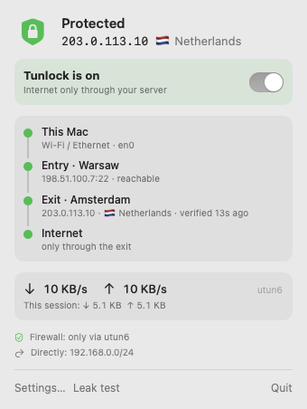
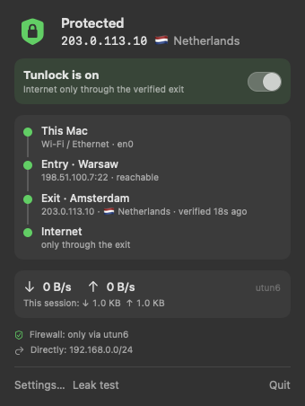
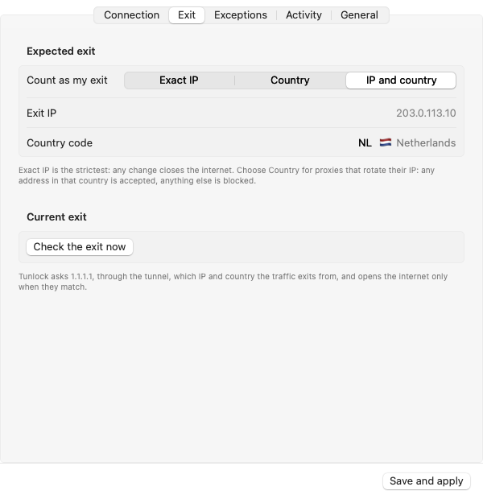
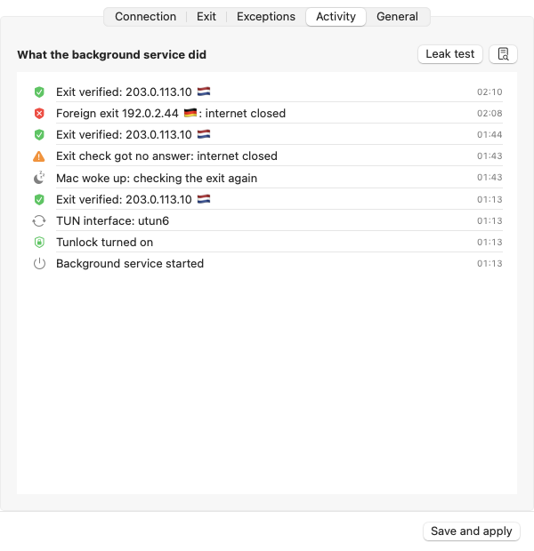
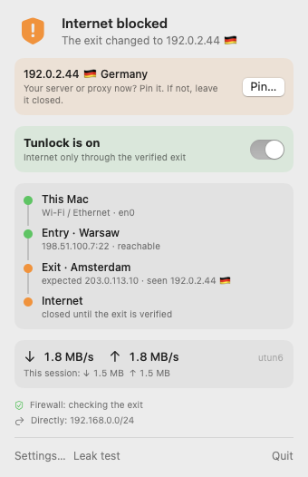
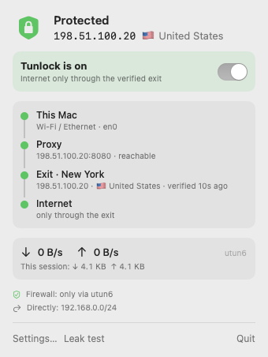
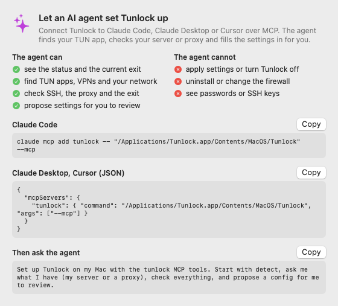

<h1 align="center">Tunlock</h1>

<p align="center">
  <b>A fail-closed SSH tunnel for macOS.</b><br>
  Your Mac reaches the internet only through your own server.<br>
  If the tunnel breaks, the internet stops. It never falls back to your real IP.
</p>

<p align="center">
  macOS 14+ · menu bar app + CLI · MIT · <b>0.1.0 preview</b> · <a href="README.ru.md">Русский</a>
</p>

<p align="center">
  
  &nbsp;
  
</p>

> **Preview.** Covered by 100+ tests, with the background guard run against
> stubbed system tools. Not yet field-tested across many real networks, sleep
> cycles and reboots. Run the [acceptance checks](docs/TESTING.md) on your Mac
> before you rely on it.

## Why

You route your Mac through your own server: an SSH tunnel plus a TUN app such
as Karing or sing-box. Then the tunnel drops, the Mac wakes from sleep on
another Wi-Fi, or the TUN app quits, and apps quietly continue over your home,
office or mobile IP. Nothing tells you.

Tunlock closes that gap at the firewall level:

- **Kill switch in pf.** Outside the verified tunnel, nothing leaves: IPv4,
  IPv6, DNS and UDP, by IP or by name.
- **Verified exit.** The internet opens only after Tunlock sees traffic leave
  with your server's IP, and it re-checks regularly.
- **Keeps the tunnel up.** It reconnects SSH after drops, sleep and network
  changes, and rebinds pf without a direct-access window.
- **One switch.** On: firewall first, then SSH, then your TUN app. Off: nothing
  blocked, tunnel stopped.

## How it works

```
 apps ──► TUN app (utunN, e.g. 10.20.0.1) ──► SSH forward ──► [relay] ──► your server ──► internet
                                                                          exit IP is verified
 pf (Tunlock anchor): everything else is dropped, IPv6 included
```

Two background parts do the work. The app is only a remote control: closing it
changes nothing.

| part | runs as | job |
|---|---|---|
| **guard** | LaunchDaemon, root | owns the pf rules, checks the exit IP, writes the status |
| **SSH keeper** | LaunchAgent, you | runs `ssh -N` with your forwards while Tunlock is on |

While Tunlock is on, the guard moves between three phases, every 2 seconds and
on every network change:

| phase | when | what may leave the Mac |
|---|---|---|
| `block` | the TUN interface is missing | SSH to your server, DHCP, loopback, your exceptions |
| `probe` | TUN is up, exit not verified yet | the above, plus one HTTPS check through the tunnel |
| `open` | the check returned your server's IP | everything through the tunnel |

Every phase ends in `block drop quick all`. The guard returns to `probe` and
closes the tunnel when any of these happens: the exit IP differs, a check gets
no answer, SSH goes down, or the Mac wakes from sleep.

**What makes the status trustworthy:**

- **Rules are confirmed.** Each rule set carries a hashed label. A phase counts
  only after pf reports that exact label.
- **It fails closed.** If pf rejects a rule set, the guard loads a minimal
  emergency block. If pf rejects that too, it takes the untrusted utun down.
- **Conflicts are detected.** If another firewall rule can decide before
  Tunlock's (another kill switch, a custom `/etc/pf.conf`), the status says
  **not protected** and names the rule.
- **Rebinding is atomic.** When the utun number changes after sleep, the anchor
  is replaced in one pf transaction, so the old block holds until the new
  rules are in.
- **Your pf setup is left alone.** Rules live in their own anchor under Apple's
  `com.apple/*`. Tunlock never edits `/etc/pf.conf` or reloads the root ruleset.

## Quick start

**You need** a TUN app (Karing, sing-box…) and one of these:

- **your own server** you can SSH into by IPv4 (host key in `~/.ssh/known_hosts`):
  Tunlock keeps the SSH tunnel up and the TUN app sends traffic into it;
- **or just a proxy** (IP, port, login, password) that already works in your TUN
  app: no server and no SSH needed, see [No server? Use your proxy](#no-server-use-your-proxy).

Tunlock manages the firewall (and SSH, if used) around the TUN app you already
use; it does not include one.

```bash
git clone https://github.com/hunbow-n/tunlock.git && cd tunlock
./build-app.sh                       # Xcode or Command Line Tools
cp -R build/Tunlock.app /Applications/ && open /Applications/Tunlock.app
```

1. The setup window opens on first launch. Enter your server and press **Check SSH**.
2. Turn on your TUN app, pick its interface from the detected list and press
   **Check exit IP**.
3. Optionally add exceptions (office or home network) and choose which VPN
   service Tunlock starts and stops.
4. Press **Save and apply**. One administrator prompt installs the background
   service. With **Switch modes without a password** checked, it never asks again.
5. Flip the switch in the menu bar.

<p align="center">
  
  
  
</p>

- **Exit tab.** Decide what counts as your exit: the exact IP (strictest), a
  country (for rotating proxies), or both. **Check the exit now** shows the IP
  and country, and one click pins them.
- **Activity tab.** What the background service did, in plain words: exit
  verified, foreign exit, Mac woke up, SSH dropped. The leak test is here too.
- **When the exit changes**, the menu says where to, keeps the internet closed
  and offers **Pin…**, but only for when you changed the server yourself.
- **Notifications** tell you when the internet closes and when protection
  returns. Short blips under four seconds are not reported.

The build is ad-hoc signed and not notarized. A copy you build yourself opens
normally. A downloaded copy needs right-click → **Open** the first time.

## No server? Use your proxy



If all you have is a proxy like `IP:PORT:USER:PASSWORD` and you use it in
Karing, that is enough. Tunlock does not need the login or password and never
sees them: they stay in Karing.

1. In Karing, add the proxy (HTTP or SOCKS5, with its login and password) and
   turn on **global mode**. Check that sites open.
2. In Tunlock's settings choose **Straight to a proxy (no server)**.
3. Enter only the proxy's **IP** and **port**, press **Check proxy**.
4. Pick Karing's TUN interface, press **Check exit IP**. If the proxy exits from
   a different address than its own IP, press **Use … as the expected exit IP**.
5. **Save and apply**, then flip the switch.

From then on, the Mac may only talk to that proxy. If the proxy blinks, goes
down, or Karing quits, the internet stops until traffic exits with the proxy's
IP again. For a **rotating** proxy (a new exit IP every few minutes), set the
exit to **Country** on the Exit tab: any IP in that country is accepted, any
other country keeps the internet closed.

<br clear="right">

## Let an AI agent set it up (MCP)



Tunlock is also a local [MCP](https://modelcontextprotocol.io) server, so Claude
Code, Claude Desktop or Cursor can do the setup with you. Click ✨ in the menu
for a copy-paste, or run:

```bash
claude mcp add tunlock -- "/Applications/Tunlock.app/Contents/MacOS/Tunlock" --mcp
```

Then ask: *"Set up Tunlock on my Mac with the tunlock MCP tools."*

| the agent can | the agent cannot |
|---|---|
| `status`, `detect` (TUN apps, VPNs, network, exits) | apply settings, turn Tunlock on or off |
| `check_ssh`, `check_proxy`, `check_exit` | uninstall or touch the firewall |
| `validate_config`, `propose_config` | see passwords or SSH keys |

A proposed config is only a **draft**. Tunlock opens a one-screen review:
connection, TUN app, expected exit, a live exit check, and what goes around the
tunnel. One button, **Apply and turn on**, saves it, turns protection on and
says how it ended: protected with the verified exit, or on and waiting for one.
The full settings are one click away. Advanced keys (`PF_ANCHOR`, `PROBE_URL`,
`SSH_HOST`) cannot be changed through MCP, and `check_exit` only works on a TUN
interface, so an agent never learns your direct IP. That way a prompt injection cannot talk an agent into
switching your kill switch off. The server runs on stdio, only while the agent
uses it; it opens no port.

<br clear="right">

## Configuration

The app writes `/usr/local/etc/tunlock.conf`. You can also edit it by hand; see
[`tunlock.conf.example`](tunlock.conf.example).

| key | meaning |
|---|---|
| `UPSTREAM` | `ssh` (default, your server) or `proxy` (no server: the TUN app talks to a proxy) |
| `PROXY_HOST`, `PROXY_PORT` | proxy mode: the proxy's IPv4 and port, the only host reachable outside the tunnel |
| `VPS_IP` | ssh mode: your server, the SSH target and, by default, the only accepted exit IP |
| `SSH_USER`, `SSH_PORT`, `SSH_IDENTITY` | how to log in |
| `SSH_FORWARD` | what SSH forwards: `-L …` to a proxy on the server, or `-D` for SOCKS |
| `JUMP_HOST`, `JUMP_USER`, `JUMP_PORT` | optional relay: SSH enters here and reaches `VPS_IP` from there |
| `TUN_ADDR`, `TUN_MASK` | IPv4 of your TUN app's interface; the utun number may change |
| `TUN_SERVICE` | VPN name from `scutil --nc list` (e.g. `Karing`) to start and stop with Tunlock |
| `BYPASS_NETS`, `BYPASS_DNS` | exceptions: networks reached directly, and DNS servers per domain |
| `EXPECTED_EGRESS` | the pinned exit IP, or `any` to accept any IP (then a country is required) |
| `EXPECTED_COUNTRY` | two-letter country the exit must be in, e.g. `US`; optional with a pinned IP |
| `PROBE_URL`, `PROBE_INTERVAL` | the exit check: asked where (an IPv4 literal), how often |

All addresses are IPv4 literals: DNS is blocked outside the tunnel, so names
could not be resolved to reconnect.

<details>
<summary><b>Example: Karing + Outline (Shadowsocks) behind SSH</b></summary>

```ini
VPS_IP=203.0.113.10
SSH_USER=me
SSH_FORWARD="-L 127.0.0.1:10800:127.0.0.1:8388"   # Outline listens on 8388 on the server
TUN_ADDR=10.20.0.1
TUN_MASK=0xfffffffc
TUN_SERVICE="Karing"
```

In Karing, add a Shadowsocks profile to `127.0.0.1:10800` with your Outline
key's method and password, then use global mode.
</details>

<details>
<summary><b>Example: a cascade through a relay</b></summary>

```ini
VPS_IP=203.0.113.10        # exit server: the only accepted exit IP
JUMP_HOST=198.51.100.7     # relay: the only host reachable outside the tunnel
JUMP_USER=relay
```

Only the outer SSH hop is bound to Wi-Fi/Ethernet. If the relay works but the
exit server is down, the exit check fails and the internet stays blocked. On
the relay, restrict the account to forwarding: `AllowTcpForwarding local`,
`PermitOpen 203.0.113.10:22`, no shell.
</details>

<details>
<summary><b>Example: office and home network exceptions</b></summary>

```ini
BYPASS_NETS="192.168.0.0/24"            # any port, even while the tunnel is down
BYPASS_DNS="corp.example=192.168.0.1"   # names in corp.example use that DNS server
```

These networks bypass the tunnel on every TCP and UDP port, through your
Wi-Fi/Ethernet gateway, even while a TUN app holds the default route. The
public internet stays locked to the tunnel. DNS rules become
`/etc/resolver/<domain>` files. Routes and files Tunlock did not create are
never touched.
</details>

<details>
<summary><b>Example: sing-box + plain <code>ssh -D</code> (nothing to install on the server)</b></summary>

`SSH_FORWARD="-D 127.0.0.1:1080"`, `TUN_ADDR=172.19.0.1`, and a sing-box 1.12+
config along these lines (not yet covered by test runs):

```json
{
  "dns": { "servers": [{ "type": "tcp", "tag": "remote", "server": "1.1.1.1", "detour": "proxy" }] },
  "inbounds": [{ "type": "tun", "address": ["172.19.0.1/30"], "auto_route": true }],
  "outbounds": [{ "type": "socks", "tag": "proxy", "server": "127.0.0.1", "server_port": 1080 }],
  "route": { "rules": [{ "action": "sniff" }, { "protocol": "dns", "action": "hijack-dns" }],
             "final": "proxy", "auto_detect_interface": true }
}
```

`ssh -D` carries TCP only, so DNS goes over TCP and QUIC falls back to TCP.
</details>

## Command line

Everything the app does is also a command:

```bash
tunlock on            # firewall first, then SSH and the TUN app
tunlock off           # nothing blocked, SSH port freed, TUN app stopped; asks first while Claude Code, Codex, ChatGPT run
tunlock ai-clients    # AI apps still running that would reconnect directly once off
tunlock status        # SSH, verified exit IP, pf state  (--porcelain for scripts)
sudo tunlock test     # live leak test: PASS / FAIL / SKIP per check
tunlock doctor        # check the installation
```

`on` succeeds only when the guard confirms protection for this very request.
`status` exits 0 for a confirmed state, 1 for not protected, 3 for unknown.
Logs: `/var/log/tunlock.log` (guard) and `~/Library/Logs/tunlock-ssh.log`.

Without the app: `sudo ./install.sh` (the first run creates the config), edit
the config, then run `sudo ./install.sh` again. Add `--sudoers` to switch
without a password.

## Testing

```bash
tests/run.sh               # unit + guard tests against stubbed pfctl, route, curl…; never as root
sudo tests/pf-syntax.sh    # pfctl parses (never loads) every generated rule set
```

On every push, GitHub Actions also runs [`tests/pf-live.sh`](tests/pf-live.sh)
on a throwaway macOS machine. It loads Tunlock's rules into the **real** pf and
checks them with real packets: direct IPv4, UDP and IPv6 are blocked, the
allowed entry and loopback still work, a foreign `quick` rule really opens a
leak and Tunlock reports it, and removing the rules restores the network. Then
it runs the real guard with a real `utun` interface: block without a TUN,
probe when it appears (still no direct traffic), block again when it is gone,
and rules flushed behind the guard's back come back. A failing baseline fails
the job instead of passing it. Not covered on CI: the `open` phase, which needs
a working tunnel to the outside; that one is in the
[acceptance checklist](docs/TESTING.md). The script refuses to run anywhere
else, because on a workstation it would cut the network.

The [acceptance checklist](docs/TESTING.md) covers the runs that only a real
Mac can prove: SSH down, TUN app quit, relay up but exit down, an IPv6 network,
sleep, a Wi-Fi change, a utun renumber, reboot and uninstall.

## Limits

- **Early boot:** until launchd starts the guard (seconds after boot), pf has
  no Tunlock rules.
- **Root can undo it:** `pfctl -d` or flushing the anchor works for any root
  process. The guard restores the rules within 2 seconds.
- **The local network is blocked** while on (printers, AirDrop, NAS), except
  the networks in `BYPASS_NETS`. Those are fully open, all protocols.
- **A failed check pauses traffic:** one unanswered check closes the tunnel
  until the next good answer, usually a few seconds.
- **TCP to your server's SSH port** (or the relay's) is allowed for every app,
  so SSH can reconnect.
- **Exit, not identity:** Tunlock controls where traffic leaves. Accounts,
  fingerprints, time zones and telemetry can still identify you.

## Uninstall

In the app: Settings → **Uninstall…**. Or:

```bash
sudo ./uninstall.sh            # rules removed and confirmed first, then files
sudo ./uninstall.sh --purge    # also deletes the config
```

## Similar projects

| project | difference |
|---|---|
| [SplitR](https://github.com/tasticolly/splitr) | sshuttle with a pf kill switch; blocks IPv4 only and edits `/etc/pf.conf` |
| [killswitch-menubar](https://github.com/nidecker/killswitch-menubar) | similar pf anchor design, for the WireGuard app only; utun changes need a manual reapply |
| [killswitch](https://github.com/vpn-kill-switch/killswitch) | CLI; allows all TCP/UDP to the VPN IP and flushes pf with `-Fa` |
| [Vigil](https://github.com/ursasi/vigil), [TunnelBar](https://github.com/tanmay-kulkarni/TunnelBar), [SSH Tunnel Manager](https://github.com/0fuz/ssh-tunnel-manager) | keep SSH tunnels up from the menu bar; no kill switch |

## License

[MIT](LICENSE)
