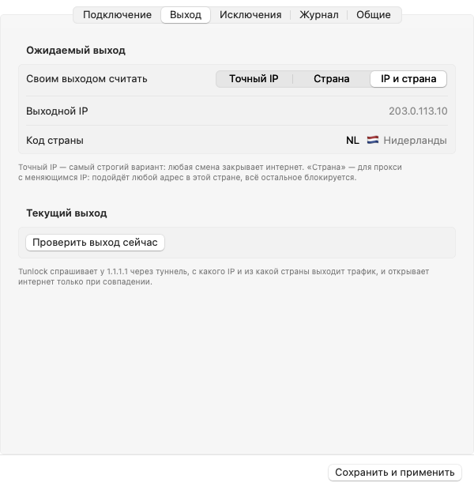
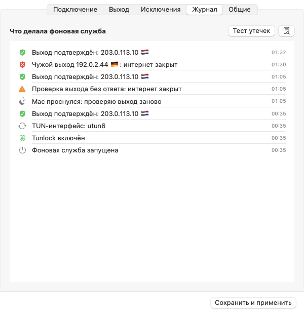
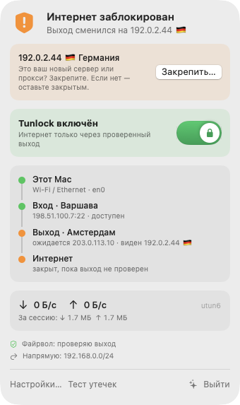
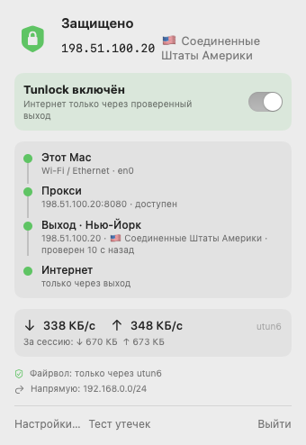
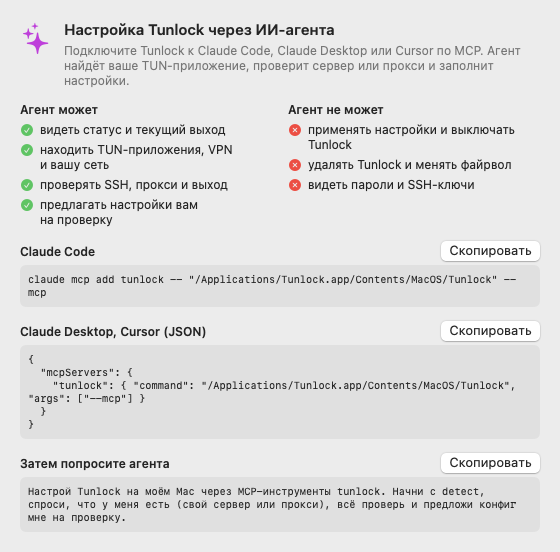

<h1 align="center">Tunlock</h1>

<p align="center">
  <b>SSH-туннель для macOS, который не пускает трафик мимо себя.</b><br>
  Mac выходит в интернет только через ваш сервер.<br>
  Оборвался туннель — интернет закрыт. На ваш настоящий IP Tunlock сам не переключается.
</p>

<p align="center">
  macOS 14+ · приложение в строке меню + CLI · MIT · <a href="https://github.com/hunbow-n/tunlock/releases/latest"></a> · <a href="README.md">English</a>
</p>

<p align="center">
  
  &nbsp;
  
</p>

> **Preview.** Сторож прогоняется 200+ тестами на заглушках системных утилит,
> и приёмка на реальном Mac пройдена: выход подтверждён по IP и по тому, что
> видят claude.ai, api.anthropic.com и chatgpt.com; прямые IPv4 и UDP-DNS
> заблокированы; при остановленном SSH-пробросе и отключённом TUN-приложении
> PF оставался включён, контрольные публичные запросы не получали ответа, а
> офисное исключение работало; после восстановления и после сна выход снова
> подтверждался. На реальном Mac ещё не проверены: переход в другую сеть,
> сеть с IPv6, перезагрузка, чистая установка и удаление, обычный прокси.
> [Результаты и чек-лист](docs/TESTING.md#results): пройдите его на своём Mac,
> прежде чем полагаться на Tunlock.

## Зачем

Вы пускаете Mac через свой сервер: SSH-туннель плюс TUN-приложение (Karing,
sing-box). Туннель обрывается, Mac просыпается в другой Wi‑Fi, TUN-приложение
закрывается — и программы молча продолжают работать через домашний, офисный
или мобильный IP. Никто об этом не сообщает.

Tunlock закрывает эту дыру на уровне файрвола:

- **Kill switch в PF.** Мимо проверенного туннеля не выходит ничего: IPv4,
  IPv6, DNS и UDP, по IP и по имени.
- **Проверенный выход.** Интернет открывается, только когда Tunlock увидел
  трафик с IP вашего сервера, и эта проверка регулярно повторяется.
- **Держит туннель.** Переподключает SSH после обрывов, сна и смены сети и
  перепривязывает PF без окна прямого доступа.
- **Одна кнопка.** Вкл: сначала файрвол, потом SSH, потом TUN-приложение.
  Выкл: ничего не блокируется, туннель остановлен.

## Как это работает

```
 программы ──► TUN (utunN, напр. 10.20.0.1) ──► SSH-проброс ──► [вход] ──► ваш сервер ──► интернет
                                                                           выходной IP проверяется
 PF (anchor Tunlock): всё остальное отбрасывается, включая IPv6
```

Работу делают две фоновые части. Приложение — только пульт: если его закрыть,
ничего не изменится.

| часть | от чьего имени | что делает |
|---|---|---|
| **сторож** | LaunchDaemon, root | управляет правилами PF, проверяет выходной IP, пишет статус |
| **SSH** | LaunchAgent, вы | держит `ssh -N` с вашими пробросами, пока Tunlock включён |

Во включённом состоянии сторож переходит между тремя фазами каждые 2 секунды
и при каждой смене сети:

| фаза | когда | что может выйти с Mac |
|---|---|---|
| `block` | TUN-интерфейса нет | SSH к серверу, DHCP, loopback, ваши исключения |
| `probe` | TUN есть, выход ещё не проверен | то же плюс одна HTTPS-проверка через туннель |
| `open` | проверка вернула IP вашего сервера | всё, что идёт через туннель |

Каждая фаза заканчивается `block drop quick all`. Сторож возвращается в `probe`
и закрывает туннель, если выходной IP не совпал, проверка не получила ответа,
упал SSH или Mac проснулся после сна.

**Почему статусу можно верить:**

- **Правила подтверждаются.** У каждого набора правил есть метка-хеш. Фаза
  засчитывается, только когда PF показывает именно эту метку.
- **Защита закрывается при отказе.** Если PF отклонил набор правил, сторож
  загружает минимальную аварийную блокировку. Если PF отклонил и её, сторож
  опускает недоверенный utun.
- **Конфликты видны.** Если другое правило файрвола может решить раньше
  Tunlock (другой kill switch, свой `/etc/pf.conf`), статус будет «Защита не
  действует» с указанием этого правила.
- **Перепривязка атомарна.** Когда после сна меняется номер utun, anchor
  заменяется одной транзакцией PF: старая блокировка действует, пока не
  загружены новые правила.
- **Ваш PF не трогается.** Правила живут в своём anchor внутри Apple
  `com.apple/*`. Tunlock не правит `/etc/pf.conf` и не перезагружает корневой набор.

## Быстрый старт

**Что нужно:** TUN-приложение (Karing, sing-box…) и одно из двух:

- **свой сервер** с доступом по SSH по IPv4 (ключ сервера в `~/.ssh/known_hosts`):
  Tunlock держит SSH-туннель, TUN-приложение отправляет в него трафик;
- **или просто прокси** (IP, порт, логин, пароль), который уже работает в вашем
  TUN-приложении: сервер и SSH не нужны, см. [Нет сервера? Подойдёт прокси](#нет-сервера-подойдёт-прокси).

Tunlock управляет файрволом (и SSH, если он есть) вокруг вашего TUN-приложения,
своего у него нет.

```bash
git clone https://github.com/hunbow-n/tunlock.git && cd tunlock
./build-app.sh                       # Xcode или Command Line Tools
cp -R build/Tunlock.app /Applications/ && open /Applications/Tunlock.app
```

1. При первом запуске откроются настройки. Укажите сервер и нажмите **«Проверить SSH»**.
2. Включите TUN-приложение, выберите его интерфейс из найденных и нажмите
   **«Проверить IP сейчас»**.
3. По желанию добавьте исключения (офисная или домашняя сеть) и выберите, каким
   VPN Tunlock будет управлять.
4. Нажмите **«Сохранить и применить»**. Пароль администратора спросят один раз,
   при установке фоновой службы. С галочкой **«Переключать режимы без пароля»**
   больше его не спросят.
5. Включите переключатель в строке меню. Если при выключении ещё запущены
   AI-приложения, подтвердите или отмените действие в панели Tunlock.

<p align="center">
  
  
  
</p>

- **Вкладка «Выход».** Что считать своим выходом: точный IP (строже всего),
  страну (для ротационных прокси) или и то и другое. Кнопка «Проверить выход
  сейчас» показывает IP и страну, закрепить их можно в один клик.
- **Вкладка «Журнал».** Что делала фоновая служба, простыми словами: выход
  подтверждён, чужой выход, Mac проснулся, SSH отвалился. Там же тест утечек.
- **Если выход сменился,** меню покажет, на что именно, оставит интернет
  закрытым и предложит «Закрепить…» — это на случай, когда сервер сменили вы сами.
- **Уведомления** сообщают, когда интернет закрылся и когда защита вернулась.
  Короткие сбои меньше четырёх секунд не тревожат.
- **Что видят AI-сервисы.** Проверка выхода и тест утечек спрашивают у
  `claude.ai`, `api.anthropic.com` и `chatgpt.com`, с какого адреса к ним пришли:
  TUN-приложение может направлять их другим маршрутом. Меню предупреждает, если
  часовой пояс Mac не совпадает со страной выхода — сайты его видят.
- **Перед сном** туннель закрывается, а после пробуждения открывается только
  после новой проверки выхода. Mac, проснувшийся в другой Wi‑Fi, ничего не
  отправит через туннель, который мог переподключиться не туда.

Сборка подписана ad-hoc и не нотаризована. Собранная у себя копия открывается
как обычно. Скачанную копию в первый раз открывайте через правый клик → **«Открыть»**.

## Нет сервера? Подойдёт прокси



Если у вас есть только прокси вида `IP:PORT:USER:PASSWORD` и вы пользуетесь им
через Karing, этого достаточно. Логин и пароль Tunlock не нужны, и он их не
видит: они остаются в Karing.

1. В Karing добавьте прокси (HTTP или SOCKS5, с логином и паролем) и включите
   **глобальный режим**. Проверьте, что сайты открываются.
2. В настройках Tunlock выберите **«Напрямую через прокси (без сервера)»**.
3. Укажите только **IP** и **порт** прокси, нажмите **«Проверить прокси»**.
4. Выберите TUN-интерфейс Karing и нажмите **«Проверить IP сейчас»**. Если
   прокси выходит в интернет не со своего IP, нажмите **«Использовать … как
   ожидаемый выходной IP»**.
5. **«Сохранить и применить»**, затем включите переключатель.

Дальше Mac может связываться только с этим прокси. Если прокси моргнул, упал
или Karing закрылся, интернет закрывается, пока трафик снова не выйдет с IP
прокси. Для **ротационного** прокси (новый выходной IP каждые несколько минут)
выберите на вкладке «Выход» вариант **«Страна»**: подойдёт любой IP этой страны,
а выход из другой страны оставит интернет закрытым.

<br clear="right">

## Настройка через ИИ-агента (MCP)



Tunlock — ещё и локальный [MCP](https://modelcontextprotocol.io)-сервер, поэтому
Claude Code, Claude Desktop или Cursor могут настроить его вместе с вами. Нажмите
✨ в меню и скопируйте готовую команду или выполните:

```bash
claude mcp add tunlock -- "/Applications/Tunlock.app/Contents/MacOS/Tunlock" --mcp
```

Потом попросите: *«Настрой Tunlock на моём Mac через MCP-инструменты tunlock»*.

| агент может | агент не может |
|---|---|
| `status`, `detect` (TUN-приложения, VPN, сеть, выходы) | применять настройки, включать и выключать Tunlock |
| `check_ssh`, `check_proxy`, `check_exit` | удалять Tunlock и трогать файрвол |
| `validate_config`, `propose_config` | видеть пароли и SSH-ключи |

Предложенный агентом конфиг — только **черновик**. Tunlock открывает экран
подтверждения: подключение, TUN-приложение, ожидаемый выход, живая проверка
выхода и что пойдёт мимо туннеля. Одна кнопка **«Применить и включить»**
сохраняет, включает защиту и показывает итог: «защищено, выход подтверждён» или
«включён и ждёт подтверждённого выхода». Полные настройки — в один клик.
Расширенные параметры (`PF_ANCHOR`, `PROBE_URL`, `SSH_HOST`) через MCP менять
нельзя, а `check_exit` работает только через TUN-интерфейс, поэтому агент не
узнает ваш прямой IP. Так никакая подсказка со
стороннего сайта не уговорит агента выключить вам kill switch. Сервер работает
через stdio и только пока им пользуется агент, порты он не открывает.

<br clear="right">

## Настройка

Приложение записывает `/usr/local/etc/tunlock.conf`, его можно править и
вручную, см. [`tunlock.conf.example`](tunlock.conf.example).

| ключ | что это |
|---|---|
| `UPSTREAM` | `ssh` (по умолчанию, свой сервер) или `proxy` (без сервера: TUN-приложение ходит в прокси) |
| `PROXY_HOST`, `PROXY_PORT` | режим прокси: IPv4 и порт прокси, единственный хост, доступный мимо туннеля |
| `VPS_IP` | режим ssh: ваш сервер, цель SSH и по умолчанию единственный допустимый выходной IP |
| `SSH_USER`, `SSH_PORT`, `SSH_IDENTITY` | как входить |
| `SSH_FORWARD` | что пробрасывает SSH: `-L …` к прокси на сервере или `-D` для SOCKS |
| `JUMP_HOST`, `JUMP_USER`, `JUMP_PORT` | необязательный вход: SSH заходит сюда и уже отсюда идёт на `VPS_IP` |
| `TUN_ADDR`, `TUN_MASK` | IPv4 интерфейса TUN-приложения; номер utun может меняться |
| `TUN_SERVICE` | имя VPN из `scutil --nc list` (напр. `Karing`), который включается и выключается вместе с Tunlock. Если обновление TUN-приложения зарегистрировало VPN под новым именем и старый сервис больше не запускается, Tunlock управляет новым: только если такой сервис `<имя> (…)` того же приложения один, выбирается по UUID |
| `BYPASS_NETS`, `BYPASS_DNS` | исключения: сети напрямую и DNS-серверы для доменов |
| `EXPECTED_EGRESS` | закреплённый выходной IP или `any` — любой IP (тогда нужна страна) |
| `EXPECTED_COUNTRY` | двухбуквенный код страны выхода, напр. `US`; с закреплённым IP — по желанию |
| `PROBE_URL`, `PROBE_INTERVAL` | проверка выхода: где спрашивать (IPv4-адрес) и как часто |

Все адреса — только IPv4: вне туннеля DNS заблокирован, по имени SSH не смог
бы переподключиться.

SSH-проброс держит фоновый job: после обрыва следующая попытка ждёт чуть дольше
(до минуты), поэтому мигающий вход или вход, ограничивающий частоту новых
подключений, не получает шквал повторов. Сторож запускает TUN-приложение, когда
проброс (или, для прокси, его порт) поднят, и запускает снова, если
TUN-приложение сдалось, пока проброс лежал. Только при подтверждённых правилах
файрвола и не больше трёх попыток с интервалом в минуту на каждое восстановление
проброса. TUN-приложение, которое вы сами остановили после того, как туннель
работал, остаётся остановленным.

<details>
<summary><b>Пример: Karing + Outline (Shadowsocks) за SSH</b></summary>

```ini
VPS_IP=203.0.113.10
SSH_USER=me
SSH_FORWARD="-L 127.0.0.1:10800:127.0.0.1:8388"   # Outline на сервере слушает 8388
TUN_ADDR=10.20.0.1
TUN_MASK=0xfffffffc
TUN_SERVICE="Karing"
```

В Karing добавьте профиль Shadowsocks на `127.0.0.1:10800` с методом и паролем
из ключа Outline и включите глобальный режим.
</details>

<details>
<summary><b>Пример: каскад через промежуточный сервер</b></summary>

```ini
VPS_IP=203.0.113.10        # сервер выхода: единственный допустимый выходной IP
JUMP_HOST=198.51.100.7     # вход: единственный хост, доступный мимо туннеля
JUMP_USER=relay
```

К Wi‑Fi/Ethernet привязан только внешний участок SSH. Если вход работает, а
сервер выхода упал, проверка выхода не проходит, и интернет остаётся закрытым.
На входе ограничьте учётку пробросом: `AllowTcpForwarding local`,
`PermitOpen 203.0.113.10:22`, без shell.
</details>

<details>
<summary><b>Пример: исключения для офисной и домашней сети</b></summary>

```ini
BYPASS_NETS="192.168.0.0/24"            # любой порт, даже когда туннель лежит
BYPASS_DNS="corp.example=192.168.0.1"   # имена corp.example — через этот DNS
```

Эти сети идут мимо туннеля на любом порту TCP и UDP, через шлюз Wi‑Fi/Ethernet,
даже когда маршрут по умолчанию держит TUN-приложение. Публичный интернет
по-прежнему только через туннель. DNS-правила становятся файлами
`/etc/resolver/<домен>`. Чужие маршруты и файлы Tunlock не трогает.
</details>

<details>
<summary><b>Claude закрыт вне туннеля, даже когда Tunlock выключен</b></summary>

Tunlock держит собственные сети Anthropic (`160.79.104.0/21`,
`2607:6bc0::/32`: api.anthropic.com, claude.ai, claude.com) закрытыми вне
туннеля в обоих режимах:

- **включён:** к ним можно попасть только через проверенный туннель, никакое
  исключение из `BYPASS_NETS` не откроет их напрямую;
- **выключен:** всё остальное идёт напрямую как обычно, но Claude Code, Claude
  Desktop, плагины IDE и claude.ai в браузере не подключатся, пока Tunlock
  снова не включён. Открытые соединения с этими сетями сбрасываются при
  выключении.

`status` показывает строку `Closed` с сетями, а если PF не принял правила —
предупреждение. Сторонние сервисы, к которым приложение тоже обращается
(телеметрия, загрузки вне сетей Anthropic), не закрываются. `AI_NETS="..."`
задаёт другие сети, `AI_NETS=none` отключает закрытие.
</details>

## Командная строка

Всё, что делает приложение, доступно и командами:

```bash
tunlock on            # сначала файрвол, потом SSH и TUN-приложение
tunlock off           # ничего не блокирует, порт SSH свободен, TUN-приложение выключено; спросит, если запущены Claude Code, Codex, ChatGPT
tunlock ai-clients    # какие AI-приложения запущены и выйдут напрямую после off
tunlock run -- claude # запустить команду только после свежей проверки выхода (125 при отказе)
tunlock status        # SSH, проверенный выходной IP, состояние PF, причина блокировки (--porcelain для скриптов)
sudo tunlock test     # живой тест утечек: PASS / FAIL / SKIP по каждой проверке и что не подтверждено (UNCONFIRMED)
tunlock doctor        # проверка установки
```

`on` завершается успешно, только если сторож подтвердил защиту именно для этого
запроса. `status` возвращает 0 при подтверждённом состоянии, 1 — если защиты
нет, 3 — если состояние неизвестно. Если интернет заблокирован или защита не
действует, строка `Reason` называет первую причину и что делать: нет
TUN-интерфейса, TCP-порт входа недоступен, SSH отвалился, чужой выход, выход не
ответил или сбой PF. Для прокси «TCP-порт доступен» значит только, что порт
отвечает, а выход проверяется отдельно. Для старого состояния выводится
`stale`, а не последняя причина. В `--porcelain` это поле `reason=`, приложение
и MCP используют те же коды. Логи: `/var/log/tunlock.log` (сторож) и
`~/Library/Logs/tunlock-ssh.log`.

`tunlock run [--quiet] [--timeout N] -- команда [аргументы]` работает от вашего
имени, без sudo. Он просит сторожа сделать свежую проверку выхода именно для
этого запроса и запускает команду, только если эта проверка застала включённую
защиту, подтверждённый выход и неизменную с запуска сторожа конфигурацию.
Проверка делается прямо перед запуском; потом она защиту не удерживает, и
выключение в тот же момент пока не исключено (#21). Иначе код 125 и
причина; 126/127 значат, что команду нельзя запустить. Команда занимает место
`tunlock run`, поэтому вывод, терминал, Ctrl-C и код возврата у неё свои.
После запуска её защищает файрвол, как любую другую программу: если выход
пропал, трафик блокируется, а не идёт напрямую. Выключение Tunlock её не
останавливает: дальше она ходит напрямую, как и всё остальное.

Без приложения: `sudo ./install.sh` (первый запуск создаёт конфиг), правите
конфиг, ещё раз `sudo ./install.sh`. Флаг `--sudoers` разрешает переключаться
без пароля.

## Тесты

```bash
tests/run.sh               # модульные тесты и сторож на заглушках pfctl, route, curl…; не под root
sudo tests/pf-syntax.sh    # pfctl разбирает (но не загружает) каждый набор правил
```

При каждом push GitHub Actions ещё и запускает [`tests/pf-live.sh`](tests/pf-live.sh)
на одноразовой машине macOS. Скрипт загружает правила Tunlock в **настоящий** PF
и проверяет их реальными пакетами:
- прямые IPv4, UDP и IPv6 закрыты;
- разрешённый вход и loopback работают;
- чужое правило `quick` действительно открывает утечку, и Tunlock о нём сообщает;
- после снятия правил сеть возвращается.

Затем скрипт запускает настоящий сторож с настоящим интерфейсом `utun` и
проверяет его фазы:
- без TUN — `block`;
- TUN появился — `probe`, прямой трафик по-прежнему закрыт;
- TUN пропал — снова `block`;
- правила, сброшенные в обход сторожа, возвращаются.

Если на старте у машины нет сети, задача падает, а не проходит «зелёной». На CI
не проверяется фаза `open`: для неё нужен работающий туннель наружу, она есть в
[приёмочном чек-листе](docs/TESTING.md).

Больше нигде скрипт не запустится: на рабочем компьютере он бы отрезал сеть.

[Приёмочный чек-лист](docs/TESTING.md) — то, что доказывает только живой Mac:
упавший SSH, закрытое TUN-приложение, работающий вход при упавшем выходе,
сеть с IPv6, сон, смена Wi‑Fi, смена номера utun, перезагрузка и удаление.

## Ограничения

- **Ранняя загрузка:** пока launchd не запустил сторож (секунды после старта),
  правил Tunlock в PF нет.
- **Выключение без сторожа:** если сторож не запущен, `tunlock off` снимает все
  правила, включая то, что держит Claude закрытым.
- **Root может всё отменить:** `pfctl -d` или очистка anchor доступны любому
  процессу root. Сторож восстанавливает правила за 2 секунды.
- **Локальная сеть закрыта**, пока Tunlock включён (принтеры, AirDrop, NAS),
  кроме сетей из `BYPASS_NETS`. Они открыты полностью, для всех протоколов.
- **Сбой проверки ставит трафик на паузу:** одна проверка без ответа закрывает
  туннель до следующего удачного ответа, обычно на несколько секунд.
- **TCP к SSH-порту сервера** (или входа) разрешён любым программам, чтобы SSH
  мог переподключиться.
- **Выход, а не анонимность:** Tunlock управляет тем, откуда выходит трафик.
  Аккаунты, отпечатки браузера, часовой пояс и телеметрия всё ещё могут вас выдать.

## Загрузка

GitHub Actions собирает `Tunlock.dmg` и `SHA256SUMS.txt` (с подписью Ed25519,
когда задан ключ релизов). Как проверить скачанный файл — в
[docs/RELEASES.md](docs/RELEASES.md).

## Удаление

В приложении: «Настройки…» → **«Удалить…»**. Или:

```bash
sudo ./uninstall.sh            # сначала снимает и проверяет правила, потом удаляет файлы
sudo ./uninstall.sh --purge    # плюс удаляет конфиг
```

## Участие в проекте

Порядок работы с issue и PR, команды для проверок и правила выпуска версий
описаны в [AGENTS.md](AGENTS.md).

## Лицензия

[MIT](LICENSE)
