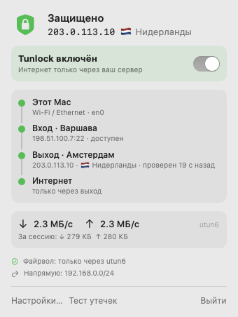
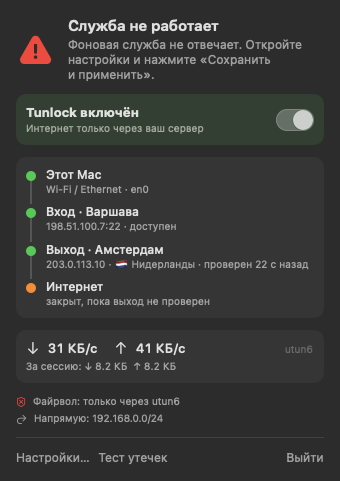

<h1 align="center">Tunlock</h1>

<p align="center">
  <b>SSH-туннель для macOS, который не пускает трафик мимо себя.</b><br>
  Mac выходит в интернет только через ваш сервер.<br>
  Оборвался туннель — интернет закрыт. На ваш настоящий IP Tunlock сам не переключается.
</p>

<p align="center">
  macOS 14+ · приложение в строке меню + CLI · MIT · <b>0.1.0 preview</b> · <a href="README.md">English</a>
</p>

<p align="center">
  
  &nbsp;
  
</p>

> **Preview.** Покрыто 100+ тестами, фоновый сторож прогоняется на заглушках
> системных утилит. На множестве реальных сетей, после сна и перезагрузок пока
> не проверялось. Прежде чем полагаться на Tunlock, пройдите
> [приёмочные проверки](docs/TESTING.md) на своём Mac.

## Зачем

Вы пускаете Mac через свой сервер: SSH-туннель плюс TUN-приложение (Karing,
sing-box). Туннель обрывается, Mac просыпается в другой Wi‑Fi, TUN-приложение
закрывается — и программы молча продолжают работать через домашний, офисный
или мобильный IP. Никто об этом не сообщает.

Tunlock закрывает эту дыру на уровне файрвола:

- **Kill switch в PF.** Мимо проверенного туннеля не выходит ничего: IPv4,
  IPv6, DNS и UDP, по IP и по имени.
- **Проверенный выход.** Интернет открывается, только когда Tunlock увидел
  трафик с IP вашего сервера, и эта проверка регулярно повторяется.
- **Держит туннель.** Переподключает SSH после обрывов, сна и смены сети и
  перепривязывает PF без окна прямого доступа.
- **Одна кнопка.** Вкл: сначала файрвол, потом SSH, потом TUN-приложение.
  Выкл: ничего не блокируется, туннель остановлен.

## Как это работает

```
 программы ──► TUN (utunN, напр. 10.20.0.1) ──► SSH-проброс ──► [вход] ──► ваш сервер ──► интернет
                                                                           выходной IP проверяется
 PF (anchor Tunlock): всё остальное отбрасывается, включая IPv6
```

Работу делают две фоновые части. Приложение — только пульт: если его закрыть,
ничего не изменится.

| часть | от чьего имени | что делает |
|---|---|---|
| **сторож** | LaunchDaemon, root | управляет правилами PF, проверяет выходной IP, пишет статус |
| **SSH** | LaunchAgent, вы | держит `ssh -N` с вашими пробросами, пока Tunlock включён |

Во включённом состоянии сторож переходит между тремя фазами каждые 2 секунды
и при каждой смене сети:

| фаза | когда | что может выйти с Mac |
|---|---|---|
| `block` | TUN-интерфейса нет | SSH к серверу, DHCP, loopback, ваши исключения |
| `probe` | TUN есть, выход ещё не проверен | то же плюс одна HTTPS-проверка через туннель |
| `open` | проверка вернула IP вашего сервера | всё, что идёт через туннель |

Каждая фаза заканчивается `block drop quick all`. Сторож возвращается в `probe`
и закрывает туннель, если выходной IP не совпал, проверка не получила ответа,
упал SSH или Mac проснулся после сна.

**Почему статусу можно верить:**

- **Правила подтверждаются.** У каждого набора правил есть метка-хеш. Фаза
  засчитывается, только когда PF показывает именно эту метку.
- **Защита закрывается при отказе.** Если PF отклонил набор правил, сторож
  загружает минимальную аварийную блокировку. Если PF отклонил и её, сторож
  опускает недоверенный utun.
- **Конфликты видны.** Если другое правило файрвола может решить раньше
  Tunlock (другой kill switch, свой `/etc/pf.conf`), статус будет «Защита не
  действует» с указанием этого правила.
- **Перепривязка атомарна.** Когда после сна меняется номер utun, anchor
  заменяется одной транзакцией PF: старая блокировка действует, пока не
  загружены новые правила.
- **Ваш PF не трогается.** Правила живут в своём anchor внутри Apple
  `com.apple/*`. Tunlock не правит `/etc/pf.conf` и не перезагружает корневой набор.

## Быстрый старт

**Что нужно:** сервер, куда можно зайти по SSH по IPv4 (его ключ в
`~/.ssh/known_hosts`), и TUN-приложение, прокси которого смотрит на локальный
SSH-проброс. Tunlock управляет SSH и файрволом вокруг вашего TUN-приложения,
своего у него нет.

```bash
git clone https://github.com/hunbow-n/tunlock.git && cd tunlock
./build-app.sh                       # Xcode или Command Line Tools
cp -R build/Tunlock.app /Applications/ && open /Applications/Tunlock.app
```

1. При первом запуске откроются настройки. Укажите сервер и нажмите **«Проверить SSH»**.
2. Включите TUN-приложение, выберите его интерфейс из найденных и нажмите
   **«Проверить IP сейчас»**.
3. По желанию добавьте исключения (офисная или домашняя сеть) и выберите, каким
   VPN Tunlock будет управлять.
4. Нажмите **«Сохранить и применить»**. Пароль администратора спросят один раз,
   при установке фоновой службы. С галочкой **«Переключать режимы без пароля»**
   больше его не спросят.
5. Включите переключатель в строке меню.

Сборка подписана ad-hoc и не нотаризована. Собранная у себя копия открывается
как обычно. Скачанную копию в первый раз открывайте через правый клик → **«Открыть»**.

## Настройка

Приложение записывает `/usr/local/etc/tunlock.conf`, его можно править и
вручную, см. [`tunlock.conf.example`](tunlock.conf.example).

| ключ | что это |
|---|---|
| `VPS_IP` | ваш сервер: цель SSH и по умолчанию единственный допустимый выходной IP |
| `SSH_USER`, `SSH_PORT`, `SSH_IDENTITY` | как входить |
| `SSH_FORWARD` | что пробрасывает SSH: `-L …` к прокси на сервере или `-D` для SOCKS |
| `JUMP_HOST`, `JUMP_USER`, `JUMP_PORT` | необязательный вход: SSH заходит сюда и уже отсюда идёт на `VPS_IP` |
| `TUN_ADDR`, `TUN_MASK` | IPv4 интерфейса TUN-приложения; номер utun может меняться |
| `TUN_SERVICE` | имя VPN из `scutil --nc list` (напр. `Karing`), который включается и выключается вместе с Tunlock |
| `BYPASS_NETS`, `BYPASS_DNS` | исключения: сети напрямую и DNS-серверы для доменов |
| `EXPECTED_EGRESS`, `PROBE_URL`, `PROBE_INTERVAL` | проверка выхода: какой IP, где спрашивать, как часто |

Все адреса — только IPv4: вне туннеля DNS заблокирован, по имени SSH не смог
бы переподключиться.

<details>
<summary><b>Пример: Karing + Outline (Shadowsocks) за SSH</b></summary>

```ini
VPS_IP=203.0.113.10
SSH_USER=me
SSH_FORWARD="-L 127.0.0.1:10800:127.0.0.1:8388"   # Outline на сервере слушает 8388
TUN_ADDR=10.20.0.1
TUN_MASK=0xfffffffc
TUN_SERVICE="Karing"
```

В Karing добавьте профиль Shadowsocks на `127.0.0.1:10800` с методом и паролем
из ключа Outline и включите глобальный режим.
</details>

<details>
<summary><b>Пример: каскад через промежуточный сервер</b></summary>

```ini
VPS_IP=203.0.113.10        # сервер выхода: единственный допустимый выходной IP
JUMP_HOST=198.51.100.7     # вход: единственный хост, доступный мимо туннеля
JUMP_USER=relay
```

К Wi‑Fi/Ethernet привязан только внешний участок SSH. Если вход работает, а
сервер выхода упал, проверка выхода не проходит, и интернет остаётся закрытым.
На входе ограничьте учётку пробросом: `AllowTcpForwarding local`,
`PermitOpen 203.0.113.10:22`, без shell.
</details>

<details>
<summary><b>Пример: исключения для офисной и домашней сети</b></summary>

```ini
BYPASS_NETS="192.168.0.0/24"            # любой порт, даже когда туннель лежит
BYPASS_DNS="corp.example=192.168.0.1"   # имена corp.example — через этот DNS
```

Эти сети идут мимо туннеля на любом порту TCP и UDP, через шлюз Wi‑Fi/Ethernet,
даже когда маршрут по умолчанию держит TUN-приложение. Публичный интернет
по-прежнему только через туннель. DNS-правила становятся файлами
`/etc/resolver/<домен>`. Чужие маршруты и файлы Tunlock не трогает.
</details>

## Командная строка

Всё, что делает приложение, доступно и командами:

```bash
tunlock on            # сначала файрвол, потом SSH и TUN-приложение
tunlock off           # ничего не блокирует, порт SSH свободен, TUN-приложение выключено
tunlock status        # SSH, проверенный выходной IP, состояние PF (--porcelain для скриптов)
sudo tunlock test     # живой тест утечек: PASS / FAIL / SKIP по каждой проверке
tunlock doctor        # проверка установки
```

`on` завершается успешно, только если сторож подтвердил защиту именно для этого
запроса. `status` возвращает 0 при подтверждённом состоянии, 1 — если защиты
нет, 3 — если состояние неизвестно. Логи: `/var/log/tunlock.log` (сторож) и
`~/Library/Logs/tunlock-ssh.log`.

Без приложения: `sudo ./install.sh` (первый запуск создаёт конфиг), правите
конфиг, ещё раз `sudo ./install.sh`. Флаг `--sudoers` разрешает переключаться
без пароля.

## Тесты

```bash
tests/run.sh               # модульные тесты и сторож на заглушках pfctl, route, curl…; не под root
sudo tests/pf-syntax.sh    # pfctl разбирает (но не загружает) каждый набор правил
```

[Приёмочный чек-лист](docs/TESTING.md) — то, что доказывает только живой Mac:
упавший SSH, закрытое TUN-приложение, работающий вход при упавшем выходе,
сеть с IPv6, сон, смена Wi‑Fi, смена номера utun, перезагрузка и удаление.

## Ограничения

- **Ранняя загрузка:** пока launchd не запустил сторож (секунды после старта),
  правил Tunlock в PF нет.
- **Root может всё отменить:** `pfctl -d` или очистка anchor доступны любому
  процессу root. Сторож восстанавливает правила за 2 секунды.
- **Локальная сеть закрыта**, пока Tunlock включён (принтеры, AirDrop, NAS),
  кроме сетей из `BYPASS_NETS`. Они открыты полностью, для всех протоколов.
- **Сбой проверки ставит трафик на паузу:** одна проверка без ответа закрывает
  туннель до следующего удачного ответа, обычно на несколько секунд.
- **TCP к SSH-порту сервера** (или входа) разрешён любым программам, чтобы SSH
  мог переподключиться.
- **Выход, а не анонимность:** Tunlock управляет тем, откуда выходит трафик.
  Аккаунты, отпечатки браузера, часовой пояс и телеметрия всё ещё могут вас выдать.

## Удаление

В приложении: «Настройки…» → **«Удалить…»**. Или:

```bash
sudo ./uninstall.sh            # сначала снимает и проверяет правила, потом удаляет файлы
sudo ./uninstall.sh --purge    # плюс удаляет конфиг
```

## Лицензия

[MIT](LICENSE)
